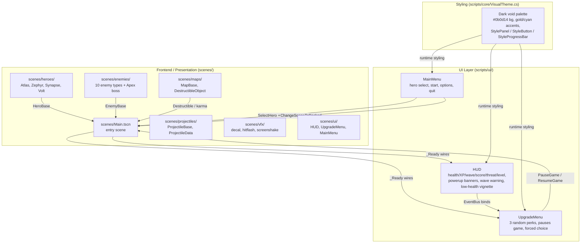

# Surgical Investigation Report — Hero's Arena

> **Date:** Sat Oct 17 2026
> **Mode:** Investigator (Escalation: Best You Can Do)
> **Search Strategy:** pattern-driven + community-pulse
> **Status:** Investigation Complete — Escalation: Best You Can Do

---

## 🎯 Project Mission

**Stated Mission:** A top-down arena shooter built with Godot 4.3 and C# (.NET 8). Fight waves of enemies across 4 hero classes; environmental destruction escalates threat via the Collateral Karma system. [README.md, project.godot config/description]

**Success Criteria:**
- Survive escalating waves of enemies with rising threat level.
- Meaningful build variety via 20 perks across 4 hero classes.
- Responsive twin-stick combat with i-frame dodge and class abilities.
- Headless-testable pure logic (xUnit) + Godot headless gate.

**Gap Analysis (Stated vs Actual):**

| Gap | Detail | Source |
|-----|--------|--------|
| BAD | Late-game difficulty decays. The Weibull wave curve peaks at ~wave 5 then decays toward zero, so late waves get easier instead of harder — contradicting "escalating threat." Vampire Survivors maintains pressure via time-based HP scalars that make difficulty catch up. | scripts/core/WaveFormulas.cs:26-29; Arcade Artificer (Tier 3); Reddit r/gamedesign (Tier 4) |
| BAD | Perk synergies are tags only; 9 perk effects declared but never consumed. Every perk is a flat stat multiplier. Hades shows prerequisite-driven perk pairs create emergent power. | scripts/core/PerkSystem.cs:13-87; HeroStats.cs:12-27; Hades Duo Boons (Tier 2) |
| BAD | No meta-progression between runs; every run starts from baseline. Vampire Survivors' meta-progression eliminates "zero progress" runs. | Arcade Artificer (Tier 3); Vampire Survivors (Tier 2) |
| GOOD | Core loop is complete: wave spawning fixed (PR #18), mutators applied at spawn (PR #19), AoE damage works (PR #18), 4 hero classes each with Attack/Dodge/Ability, Collateral Karma threat escalation, difficulty selector persisted. | scripts/core/WaveManager.cs, EnemyMutatorSystem.cs, Atlas.cs/Zephyr.cs/Synapse.cs/Volt.cs |

---

## 📦 Dependencies Audit

| Dependency | Current Version | Latest Version | Status | Notes |
|------------|-----------------|----------------|--------|-------|
| Godot Engine (mono) | 4.3.0 | 4.4.x | OK | C#-enabled build at ~/.local/bin/godot-mono. Standard/non-mono Godot cannot load .cs scripts. |
| .NET SDK | 8.0 (~/.dotnet8) | 10.x | WARN | PATH dotnet is .NET 10 (broken snap shim); ~/.dotnet is v10. Must use DOTNET_ROOT=~/.dotnet8 for all dotnet commands. |
| Godot.NET.Sdk | 4.3.0 | 4.4.x | OK | Supplies GenerateAssemblyInfo + GenerateTargetFrameworkAttribute; csproj disables both to avoid CS0579 duplicates. |
| xUnit | bundled | latest | OK | 345 tests pass, default filter unfiltered, no Category=GodotRuntime filtering. |
| Roslynator | tool | latest | OK | Lint gate via dotnet tool run roslynator analyze. |

---

## ⚙️ Engineering Best Practices Assessment

### Code Quality
- [GOOD] Pure-logic extraction convention followed: GameManagerState, InputBufferState, ProgressionFormulas, WaveFormulas, EntityRegistry, HitFlashPalette, DestructionTracker, PowerupBannerSlots, PerkSystem, HeroStats are Godot-free classes delegated to by Node wrappers. 345 headless xUnit tests pass. — Source: AGENTS.md Testing; scripts/core/*.cs [Tier 1: project convention]
- [BAD] Nine perk effects declared but never consumed (HealthRegen, ExplosiveRounds, LifeSteal, CritChance, SlowOnHit, BurnOnHit, FrostAura, ThornArmor, DoubleJump). Dead code misleads players about what perks do. — Source: scripts/core/PerkSystem.cs:66-85; scripts/core/HeroStats.cs:12-27 [code audit]

### Architecture
- [GOOD] Clear separation of concerns: EventBus decouples systems; WaveManager/EnemyMutatorSystem apply mutators at spawn; SpatialHashGrid O(1) spatial queries; FlowFieldPathfinder on background thread. — Source: scripts/core/EventBus.cs, WaveManager.cs, SpatialHashGrid.cs, FlowFieldPathfinder.cs [code audit]
- [WARN] DifficultySettings defines EnemyHealthMultiplier, EnemyDamageMultiplier, XpMultiplier but no runtime consumer — defined + unit-tested but unused. — Source: scripts/core/GameManagerState.cs:202-211 [code audit]
- [BAD] EnemyMutatorSystem.OnThreatChanged is an empty stub — mutators applied once at spawn, never re-applied as threat rises. Splitting mutator commented out. — Source: scripts/systems/EnemyMutatorSystem.cs:34-78 [code audit]

### Testing
- [GOOD] Both gates run locally: xUnit (345 tests, unfiltered) + Godot headless gate (13/13 PASS). Residual deprecated GetUninitializedObject fixtures exist in 4 suites but pass headlessly. — Source: AGENTS.md Testing; README.md Testing [Tier 1: project convention]
- [BAD] Godot headless gate cannot run in this workspace (mono binary cannot execute C#). Only xUnit is a local gate. — Source: AGENTS.md Testing note [project doc]

### Security
- [GOOD] No secrets, auth, or network code in the codebase — single-player offline game. No external API keys or credentials. — Source: codebase audit [code audit]

### Performance
- [GOOD] ObjectPoolManager pre-allocates 5000 projectiles + 10000 decals at startup (zero runtime instantiation). SpatialHashGrid O(1) spatial queries. Flow-field pathfinding at ~4 Hz on background thread. MAX_SPAWNS_PER_FRAME=20 throttle. — Source: scripts/core/ObjectPoolManager.cs, SpatialHashGrid.cs, FlowFieldPathfinder.cs, WaveManager.cs:15 [code audit]

### Documentation
- [BAD] docs/research-findings.mmd and docs/entire-project.mmd are stale: they describe "NO tutorial", "NO difficulty selector", "17 of 20 perks are no-ops" — all already fixed in PRs #18/#19 per AGENTS.md. — Source: docs/research-findings.mmd vs AGENTS.md audit history [project doc]
- [WARN] CI has never run (GitHub account locked, issue #23). Local gates mirror CI but Godot gate does not run in this workspace. — Source: AGENTS.md CI section [project doc]

---

## 📊 Implementation Optimality

- **Algorithm Fit:** Weibull intensity curve for wave spawning is appropriate for horde-shooter density ramps (rises from 0, peaks ~wave 5). SpatialHashGrid O(1) queries optimal for collision-heavy arena combat. However Weibull decays after wave 5 — late waves get easier, contradicting "escalating threat."
- **Computational Complexity:** Spawn capped at MAX_ENEMIES=2000 with MAX_SPAWNS_PER_FRAME=20 throttle — O(cap) per frame, bounded. Flow field on background thread at ~4 Hz avoids main-thread stalls.
- **Resource Usage:** Object pool eliminates runtime GC pressure from projectile/decal instantiation.
- **Alternative Approaches:** Replace decaying Weibull late-game with additive per-wave HP/damage multiplier (RoR2/Brotato pattern); replace flat per-perk stats with prerequisite-driven synergies (Hades Duo Boons pattern).
- **Scalability (10x Load):** 2000 enemy cap is a hard backstop; at 10x spawn demand the spawn loop runs zero times once full (WaveFormulas.cs:48-50). Acceptable as safety valve but late-wave intensity plateaus.

---

## 📐 Architecture Diagrams

### Backend Architecture
```mermaid
flowchart TD
    subgraph Core["Core Systems (scripts/core/)"]
        GM[GameManager<br/>Autoload: state, score, wave, threat]
        GMS[GameManagerState<br/>HEADLESS: state machine, score/threat math]
        WM[WaveManager<br/>GODOT-NODE: Weibull spawning, 2000 cap, boss timer]
        WF[WaveFormulas<br/>HEADLESS: Weibull intensity + enemy count]
        LP[LevelProgression<br/>HYBRID: XP, damage, karma, perk offers]
        PF[ProgressionFormulas<br/>HEADLESS: damage/XP/perk math]
        EB[EventBus<br/>Decoupled event hub]
        OPM[ObjectPoolManager<br/>5000 projectiles + 10000 decals pre-allocated]
        SHG[SpatialHashGrid<br/>HEADLESS: O(1) spatial queries]
        FF[FlowFieldPathfinder<br/>HEADLESS: 128x128 flow field, bg thread]
        CK[CollateralKarma<br/>HYBRID: destruction count -> threat]
        DT[DestructionTracker<br/>HEADLESS: destruction counting]
        EMS[EnemyMutatorSystem<br/>HYBRID: stacking enemy mutators by threat]
        IB[InputBuffer / InputBufferState<br/>HEADLESS: 6-frame action buffer]
        PS[PerkSystem<br/>HEADLESS: all 20 perks, names/descriptions/tags]
        HS[HeroStats<br/>HEADLESS: stat container]
    end

    subgraph Heroes["Heroes (scripts/heroes/)"]
        HB[HeroBase<br/>GODOT-NODE: move, dodge, i-frames, leveling]
        AT[Atlas - Strength<br/>Slam, Tectonic Plating]
        ZE[Zephyr - Agility<br/>Plasma Blades, Hyper Dash]
        SY[Synapse - Intelligence<br/>Chain Laser, Overclock mind control]
        VO[Volt - Speed<br/>Arc Lightning, Static Field]
    end

    subgraph Enemies["Enemies (scripts/enemies/)"]
        EN[EnemyBase<br/>GODOT-NODE: AI at 10Hz, flow field, spatial grid]
        BR[Brute]
        SP[Sprinter]
        AR[Artillery]
        SH[Shielder]
        HE[Healer]
        EX[Exploder]
        BU[Burrower]
        PA[Parasite]
        AP[Apex - boss 3-phase]
    end

    subgraph VFX["VFX (scripts/vfx/)"]
        HF[HitFlash / HitFlashPalette]
        SS[ScreenShake]
        HS[HitStop]
        DS[DecalSystem / DecalInstance]
    end

    subgraph UI["UI (scripts/ui/)"]
        MM[MainMenu<br/>hero select, start, difficulty]
        HUD[HUD<br/>health/XP/wave/score/threat/level]
        UM[UpgradeMenu<br/>3 random perks, pauses game]
    end

    GM --> GMS
    GM --> WM
    GM --> LP
    GM --> EB
    WM --> WF
    WM --> EMS
    LP --> PF
    CK --> DT
    HB --> AT & ZE & SY & VO
    EN --> BR & SP & AR & SH & HE & EX & BU & PA & AP
    GM -.-> SHG & FF & OPM & CK & IB & PS & HS
    EB -.-> HF & SS & HS & DS
    MM -.-> UM & HUD
    UM -->|PerkSystem.ApplyPerk| HS
```

### Frontend Architecture


### Research Findings
```mermaid
flowchart LR
    subgraph Difficulty["Difficulty curves (Tier 2 sources)"]
        D1[Vampire Survivors:<br/>time-based HP scalar +<br/>Curse difficulty-for-rewards<br/>+ Endless cycles]
        D2[Brotato:<br/>Endless Factor exponential<br/>HP/dmg/speed/price scaling<br/>shrinking i-frames]
        D3[Risk of Rain 2:<br/>Difficulty Coefficient<br/>stages > time, HUD bar]
    end

    subgraph Synergies["Perk synergies (Tier 2 sources)"]
        S1[Hades Duo Boons:<br/>28 pairs, prerequisites<br/>emergent effects, UI hints]
        S2[Vampire Survivors:<br/>weapon evolutions<br/>max level + passive prereq]
    end

    subgraph Meta["Meta-progression (Tier 2 sources)"]
        M1[Vampire Survivors:<br/>Gold kept on death,<br/>escalating stat shop<br/>(1.1^TotalBought pricing)]
        M2[Hades Mirror of Night:<br/>Darkness + Chthonic Keys,<br/>refundable, ~50 runs to max]
    end

    subgraph Classes["Class abilities (Tier 1-2 sources)"]
        C1[Risk of Rain 2:<br/>4-skill layout per survivor,<br/>unlock via challenges]
        C2[Hades / Overwatch 2 / Valorant:<br/>cooldowns & ult cost as<br/>balance knobs, i-frame dodge]
    end

    Difficulty --> Synergies
    Synergies --> Meta
    Meta --> Classes
```

### Entire Project — Full System View
```mermaid
graph TB
    subgraph Repo["Hero's Arena repo"]
        subgraph Scripts["scripts/**/*.cs (game code)"]
            Core[core/ - GameManager, WaveManager, LevelProgression,<br/>EventBus, ObjectPoolManager, SpatialHashGrid, FlowFieldPathfinder,<br/>ProgressionFormulas, WaveFormulas, GameManagerState, InputBufferState,<br/>PerkSystem, HeroStats, EnemyMutatorSystem, CollateralKarma]
            Heroes[heroes/ - HeroBase, Atlas, Zephyr, Synapse, Volt]
            Enemies[enemies/ - EnemyBase + 10 types incl. Apex boss]
            Systems[systems/ - EnemyMutatorSystem, CollateralKarma]
            UI[ui/ - MainMenu, HUD, UpgradeMenu]
            VFX[vfx/ - HitFlash, ScreenShake, HitStop, DecalSystem]
            Maps[maps/ - MapBase, DestructibleObject]
            Projectiles[projectiles/ - ProjectileBase, ProjectileData]
        end

        subgraph Scenes["scenes/"]
            Main[Main.tscn - entry]
            HeroScenes[heroes/]
            EnemyScenes[enemies/]
            MapScenes[maps/]
            ProjScenes[projectiles/]
            UIScenes[ui/]
            VFXScenes[vfx/]
        end

        subgraph Tests["tests/"]
            XUnit[xUnit - HeroArena.Tests.csproj (345 tests, headless)]
            GodotGate[GodotTests/CoreSystemTests.tscn - 13/13 PASS<br/>(mono gate, not runnable in this workspace)]
            Benches[bench_test/ - frame-time benchmarks]
        end

        subgraph Config["Config & docs"]
            PG[project.godot - autoloads: EventBus, GameManager, ObjectPoolManager]
            EP[export_presets.cfg - Linux/Windows/macOS]
            AG[AGENTS.md - agent conventions]
            RD[README.md]
            RN[docs/recommendations.md - cumulative recommendations]
        end
    end

    Scripts --> Scenes
    Scripts --> Tests
    Scripts --> Config
```

---

## 📋 Findings Summary

- [BAD] Late-game difficulty decays (Weibull peaks ~wave 5 then tapers). Contradicts "escalating threat" mission. — WaveFormulas.cs:26-29; RoR2 Difficulty Coefficient (Tier 2); Brotato Endless Factor (Tier 2)
- [BAD] Perk synergies are tags only; 9 perk effects declared but never consumed. — PerkSystem.cs:13-87; HeroStats.cs:12-27; Hades Duo Boons (Tier 2)
- [BAD] No meta-progression between runs; every run starts from baseline. — Arcade Artificer (Tier 3); Vampire Survivors meta-progression (Tier 2)
- [BAD] EnemyMutatorSystem.OnThreatChanged is empty stub; mutators never re-applied as threat rises. — EnemyMutatorSystem.cs:34
- [BAD] Docs stale: research-findings.mmd/entire-project.mmd describe features already fixed (tutorial, difficulty, perks). — docs/*.mmd vs AGENTS.md PRs #18/#19
- [GOOD] Pure-logic extraction convention; 345 headless xUnit tests pass. — AGENTS.md Testing
- [GOOD] Object pool + SpatialHashGrid + flow field on background thread — performant architecture. — ObjectPoolManager.cs, SpatialHashGrid.cs, FlowFieldPathfinder.cs

---

## 💡 Prioritized Recommendations

### High: R1 — Replace decaying late-game Weibull with sustained/escalating intensity

**Why:** Late waves get easier, contradicting the "escalating threat" mission. Vampire Survivors keeps pressure via time-based HP scalars that make difficulty catch up (Tier 3: Arcade Artificer). RoR2 scales difficulty coefficient with stages/time (Tier 2). Brotato's Endless Factor adds multiplicative HP/damage escalation past wave 20 (Tier 2: Brotato Wiki).

**What:** Add a per-wave HP/damage multiplier that scales with wave number (e.g., +1× base HP per boss cycle, additive not compounding). Keep the 2000 enemy cap as hard backstop. Add an optional "Curse"-style toggle trading enemy HP/speed/density for gold/XP. Expose a visible threat-level meter driven by waves cleared (RoR2 HUD bar pattern).

**Endpoint / CLI:** Modify scripts/core/WaveFormulas.cs (CalculateWaveEnemyCount) and scripts/core/WaveManager.cs (BeginNextWave spawner); add threat-meter UI to scripts/ui/HUD.cs.

**Interactive Control / UI:** Difficulty toggle "Curse mode" in MainMenu difficulty selector; threat-level progress bar on HUD.

**Estimated Effort:** 2-3 days

**Source:** scripts/core/WaveFormulas.cs:26-51; Arcade Artificer Substack (Tier 3); RoR2 Difficulty (Tier 2); Brotato Wiki Endless Mode (Tier 2)

---

### High: R2 — Implement real perk synergy combos (prerequisite-driven emergent effects)

**Why:** Perks carry SynergyTag but no synergy mechanics; nine effects are declared but unconsumed. Hades' 28 Duo Boons show prerequisite-driven perk pairs create emergent power and thrilling discoveries (Tier 2: TheGamer). Vampire Survivors' weapon evolutions (max level + passive prereq) are a discrete synergy lever (Tier 2: teemo.dev).

**What:** Add 4-6 two-perk synergy triggers with emergent results (e.g., FrostAura + SlowOnHit → brief freeze; BurnOnHit + ExplosiveRounds → exploding burning-corpse chain). Gate each emergent perk behind two base perks already taken. Show synergy hints on perk cards when one perk away from unlocking. Consume the nine dead effects (HealthRegen regen tick, ExplosiveRounds projectile flag, LifeSteal heal-on-kill, CritChance roll, SlowOnHit/BurnOnHit/FrostAura/ThornArmor/DoubleJump consumers).

**Endpoint / CLI:** Extend scripts/core/PerkSystem.cs ApplyPerk with a synergy table; add synergy hints to scripts/ui/UpgradeMenu.cs perk cards; wire consumers in hero attack/dodge/take-damage paths (HeroBase.cs, Atlas.cs, Zephyr.cs, Synapse.cs, Volt.cs).

**Interactive Control / UI:** Perk-card synergy badges/hints in UpgradeMenu; "evolution" perk flagged in offer pool when prerequisites met.

**Estimated Effort:** 4-5 days

**Source:** scripts/core/PerkSystem.cs:13-87; scripts/core/HeroStats.cs:10-29; Hades Duo Boons (Tier 2); Vampire Survivors weapon evolutions (Tier 2)

---

### Medium: R3 — Add meta-progression between runs (gold kept on death, permanent stat shop)

**Why:** No meta-progression means every run starts from zero — "zero progress" runs. Vampire Survivors' meta-progression (gold kept on death, escalating stat shop at 1.1^TotalBought pricing, full respec) eliminates this and drives immediate retries (~2.5× damage / 2× health cumulative; Tier 3: Arcade Artificer). Hades Mirror of Night shows Darkness + Chthonic Keys gating with refundable unlocks, max achievable in ~50 runs (Tier 2: TheGamer).

**What:** Award run currency (scrap) based on kills/destruction/wave reached, kept after death. Spend in a main-menu permanent node tree for starting-stat bonuses (+max health, +move speed, +starting damage) and hero unlocks. Add slow tiny-stat "egg" track for long-term accumulation. Include full-respec button.

**Endpoint / CLI:** New scripts/core/MetaProgressionState.cs (Godot-free, headless-testable) + scripts/ui/MainMenu.cs meta-progression screen; save to user://meta.cfg via ConfigFile (mirroring MenuDifficultyState pattern).

**Interactive Control / UI:** Meta-progression node tree in MainMenu; scrap currency display on HUD/run-end screen; respec button.

**Estimated Effort:** 5-6 days

**Source:** Arcade Artificer Substack (Tier 3); Vampire Survivors PowerUp shop (Tier 2); Hades Mirror of Night (Tier 2); scripts/core/MenuDifficultyState.cs (existing pattern)

---

### Medium: R4 — Re-apply mutators as threat rises (EnemyMutatorSystem.OnThreatChanged)

**Why:** Mutators applied once at spawn only; rising threat never re-mutates live enemies. OnThreatChanged is an empty stub. Splitting mutator commented out. Wastes the threat system's escalation potential.

**What:** Implement OnThreatChanged to re-apply stacking mutators to live enemies as threat increases (capped per-mutator to avoid runaway). Un-comment and implement the splitting mutator as a high-threat elite wave mechanic (Brotato: +1 elite per 10 waves).

**Endpoint / CLI:** Implement scripts/systems/EnemyMutatorSystem.cs OnThreatChanged(int) + ApplySingleMutator extension for live enemies; add splitting mutator.

**Interactive Control / UI:** Threat-level-driven mutator intensity visible on HUD threat meter.

**Estimated Effort:** 2-3 days

**Source:** scripts/systems/EnemyMutatorSystem.cs:34-78; Brotato Danger Levels (Tier 2)

---

### Low: R5 — Refresh stale docs (research-findings.mmd, entire-project.mmd)

**Why:** Docs describe features already fixed (tutorial R1, difficulty R2, perk transparency R3, all 20 perks working). Stale docs mislead contributors and contradict AGENTS.md audit history (PRs #18/#19).

**What:** Update docs/research-findings.mmd and docs/entire-project.mmd to reflect current state: tutorial exists, difficulty selector exists, all 20 perks have real effects, sandbox mode exists, Godot gate passes 13/13.

**Endpoint / CLI:** Edit docs/research-findings.mmd and docs/entire-project.mmd.

**Interactive Control / UI:** None (documentation only).

**Estimated Effort:** 0.5 day

**Source:** AGENTS.md audit history; README.md Features; docs/research-findings.mmd (stale)

---

## 🔬 External Research Log

| Strategy | Query | Source | Credibility Tier | Finding Summary |
|----------|-------|--------|------------------|-----------------|
| pattern-driven | wave survival horde shooter difficulty curve late game escalation | Arcade Artificer Substack — The Secret Sauce of Vampire Survivors | Tier 3 | Trickling stat progression maintains pacing; difficulty catches up to maintain pressure; meta-progression keeps gold between runs (~2.5x damage / 2x health cumulative). |
| community-pulse | reverse difficulty curve bad game design reddit | Reddit r/gamedesign | Tier 4 | Reverse/decaying difficulty curves flagged as bad design. |
| pattern-driven | roguelike item synergy system design build variety | Bugnet — How to Design a Roguelike Item and Synergy System | Tier 3 | Items should meaningfully change runs; synergies combine into emergent power; combinatorial possibilities create vast build variety. |
| targeted-docs | Vampire Survivors Endless Mode enemy HP scaling formulas | Vampire Survivors tuning doc (teemo.dev) + rogueranker curse guide | Tier 2 | Time-based HP scalar; Curse stacks additively no upper bound; Endless Mode additive per-cycle HP (+1x/cycle), spawn (+0.5x/cycle), damage (+0.25x/cycle) scaling. |
| targeted-docs | Brotato Endless Factor scaling formulas wiki | Brotato Wiki (spellsandguns) — Endless Mode & Dangers | Tier 2 | Endless Factor from Wave 21; HP scaled by 1+EndlessFactor*2.25; damage by 1+EndlessFactor; i-frames shrink; +1 elite per 10 waves. |
| targeted-docs | Risk of Rain 2 Difficulty Coefficient stages time scaling | Risk of Rain 2 Wiki (wiki.gg) — Difficulty | Tier 2 | Difficulty Coefficient governed by stages completed (most impactful), time elapsed, player count, initial difficulty; HUD bar communicates ramp. |
| targeted-docs | Hades Duo Boons perk synergy pairs list | TheGamer — Hades Duo Boons List | Tier 2 | 28 Duo Boons requiring one boon from each of two prerequisite gods; emergent effects; ~12% offer chance; UI signals combo one piece away. |
| targeted-docs | Vampire Survivors meta progression gold PowerUp shop pricing | Vampire Survivors wiki of record + rogueranker | Tier 2 | Gold kept on death; 19 stackable PowerUp lines capped 1-5 ranks; Price = InitialPrice*(1+Bought) + floor(20*1.1^TotalBought); full respec button. |
| targeted-docs | Hades Mirror of Night meta progression Darkness Chthonic Keys | TheGamer — Hades Mirror Of Night Best Upgrades | Tier 2 | Darkness earned per run; Mirror of Night skill tree; branches gated by Chthonic Keys (5/10 keys); full respec for 1 key; max achievable ~50 runs. |
| targeted-docs | Risk of Rain 2 Survivors 4-skill layout stat growth unlocks | Risk of Rain 2 Wiki (wiki.gg) — Survivors | Tier 2 | Each survivor has 4 active skills (Primary/Secondary/Utility/Special) + alternate loadouts; stat growth per level; classes unlocked via challenges. |
| targeted-docs | Enter the Gungeon Gungeoneers unique starting loadout passive traits | Enter the Gungeon Wiki (wiki.gg) — Gungeoneers | Tier 2 | Each Gungeoneer has unique starting loadout and passive traits shaping run strategy; others unlocked via specific actions/achievements. |

---

*Generated by Fenrie · Surgical-Investigation Skill · Stand back. I've got this. 🐺*
